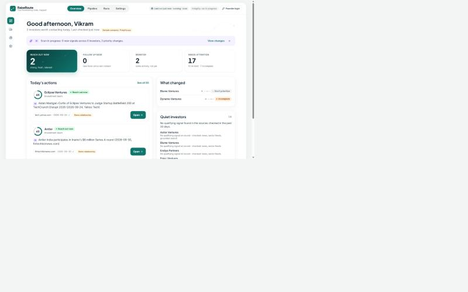
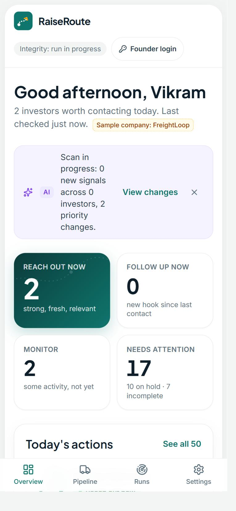

# RaiseRoute — Your fundraising route, mapped

A fundraising decision-intelligence tool for a first-time founder (Vikram, Seed round, B2B logistics SaaS). It answers one question:
**which of my 50 investors are worth contacting this week, and why?** It checks each investor's observable activity from the last 30 days
(what they wrote, said, invested in or appeared at) on live public sources, explains every recommendation with a dated, linked, verified
source, and **never touches the founder's notes or contact history**.





> Built for the MESA C4 final exam, Problem 10 (VC Fundraising Pipeline Intelligence). All AI in the product is **Gemini Flash**; there is no Claude/Anthropic API in the product (see `/runs/<id>` → AI ledger and `node scripts/check-compliance.mjs`).

## What it does

| | |
|---|---|
| **Observe** | Per investor: official blog/feed discovery, Google News RSS, nine sector news feeds (matched to investor names), optional grounded search. |
| **Understand** | Gemini Flash extracts structured events (what happened, role, date, relevance) from the *fetched page text* with no tools. |
| **Validate** | Deterministic checks V1–V15: safe URL, real page, trustworthy date (never `dateModified`), 30-day window, right investor (name collisions like "Accel" vs "accelerate"), real activity, **quote must exist verbatim in the page**, relevance cross-check, dedupe/syndication, language. Every rejection is kept and shown. |
| **Score and decide** | A 100-point explainable score and a relationship-aware action (REACH OUT NOW / FOLLOW UP NOW / MONITOR / HOLD / DON'T PRIORITIZE / INCOMPLETE) — computed by **code**, matching 30 golden test vectors exactly. |
| **Explain** | Why this investor, why now, what happened, why this score, which source proves it, how your relationship changes the advice. |
| **Quiet vs. failed** | "Quiet" needs adequate source coverage. If a source failed, the investor is **Incomplete**, never quiet. |

## Pages
`/` Command Centre (with a collapsed Opportunity Matrix) · `/pipeline` table + board with filters, CSV and "view as of an earlier run" · `/vc/[slug]` score breakdown, evidence, relationship, history, Gemini outreach draft, feedback and outcomes · `/runs`, `/runs/[id]` run audit (rejected evidence, source health, AI ledger, integrity receipt) · `/digests` immutable email archive · `/calibration` feedback and outcomes with sample sizes · `/settings` · `/how-we-verify`. There is no login: anyone can use **Run now**, edit notes/status/dates, the company profile and the scoring table (Settings). The database still blocks every write to system columns.

## Architecture
```
Vercel cron (Mon+Thu) / Run now / API trigger ─► orchestrator (idempotent run_key, task queue, time-boxed chunks that continue themselves)
   per investor: sources ─► SSRF-safe fetch ─► validators ─► Gemini extract (no tools) ─► validators ─► signals
                 ─► score + action (pure code) ─► immutable recommendation snapshot ─► apply_assessment()  ← the ONLY write to vc_pipeline
Neon Postgres: vc_pipeline (your table) + append-only history (signals, evidence_candidates, recommendations, runs, llm_calls …)
Next.js (App Router, TypeScript strict) on Vercel · Gemini Flash via @google/genai · Neon via @neondatabase/serverless
```
Full **Components Map**: [`docs/02_ARCHITECTURE_AND_COMPONENTS_MAP.md`](docs/02_ARCHITECTURE_AND_COMPONENTS_MAP.md) and the picture [`docs/components-map.png`](docs/components-map.png) (a submission file, not part of the app).

## The Integrity Guard (how your notes are protected)
Four independent layers, tested by `db/tests/guard_test.sql` (`npm run db:test`):
1. **Privileges** — the app's database role has no INSERT/UPDATE/DELETE on `vc_pipeline`.
2. **One write door** — the pipeline writes only through `apply_assessment()`, which names the signal columns explicitly and ignores anything else.
3. **Trigger** — even the table owner cannot change a founder-owned column unless the founder path set the actor flag.
4. **Receipt** — every run stores a SHA-256 fingerprint of founder-owned data before and after; `/runs/<id>` shows ✅ intact (or ⚠ if you edited during the run).

## Setup
```bash
npm install
cp .env.example .env.local        # fill in the values below
npm run db:migrate                # creates the schema and seeds the sample data in Neon (needs DATABASE_URL_UNPOOLED)
npm run db:app-role               # sets a password for the restricted app role and writes DATABASE_URL
npm run db:test                   # Integrity Guard tests (expect ALL GUARD TESTS PASSED)
npm run dev                       # http://localhost:3000
npm run pipeline:run              # run the real pipeline from the command line (or press Run now in the app)
npm run verify                    # typecheck + lint + tests + compliance script
npm run evals                     # real Gemini extraction evals (15 labelled cases)
npm run scan:secrets              # greps the build output and tracked files for the values of your secrets
```
| Variable | Purpose |
|---|---|
| `DATABASE_URL` | Neon pooled connection string for the restricted role `app_service` |
| `DATABASE_URL_UNPOOLED` | Neon owner connection string (migrations and tests only) |
| `GEMINI_API_KEY`, `GEMINI_MODEL_PRIMARY`, `GEMINI_MODEL_FALLBACKS` | Gemini Flash (default `gemini-3.8-flash`, fallbacks `gemini-3.6-flash,gemini-3.7-flash`) |
| `OPENROUTER_API_KEY` | When set, the same Gemini Flash models are called through OpenRouter (`google/gemini-*`) instead of the Google SDK. Search grounding is unavailable on this path, so set `GEMINI_ENABLE_GROUNDING=false` |
| `FOUNDER_ACCESS_CODE`, `SESSION_SECRET` | Not used any more (login was removed); can be deleted |
| `CRON_SECRET` | Bearer secret for `/api/cron/run` and `/api/pipeline/continue` |
| `PIPELINE_TIME_BUDGET_MS`, `LLM_MAX_CALLS_PER_RUN`, `MANUAL_RUN_COOLDOWN_MINUTES` | Run limits |
| `RESEND_API_KEY`, `DIGEST_RECIPIENT`, `DIGEST_FROM`, `DIGEST_AUTO_SEND` | Email digest through Resend (auto-send only after cron runs when true; manual runs never auto-send) |

## Tests
`npm test` runs 190+ tests: 30 golden scoring/action vectors, engine and validator units (including SSRF payloads, date edge cases, quote verification, entity collisions), source parsers and fetcher guards, the Gemini wrapper (retries, fallback, cap, repair), the orchestrator with fakes (idempotency, resume, failure isolation), founder auth, and live-database integration tests. `npm run evals` makes real Gemini calls on 15 hand-labelled documents (including a prompt-injection canary).

## Costs and limits
Vercel Hobby, Neon free tier and Google AI Studio. Roughly 7 Gemini calls for 5 investors in the first live trial; a full 50-investor run is on the order of 70–100 calls (estimate, not a bill). Vercel Hobby limits function duration, so a run is split into time-boxed chunks that continue themselves.

## Data and trust (also shown in the app at /how-we-verify)
* **Live:** every signal (event, date, source link, verified quote) comes from live public sources at run time.
* **Demo / synthetic:** the investors' contact status, last-contact dates, history and notes are **synthetic demo data** and are labelled "Demo data" everywhere; they can never produce a recommendation by themselves.
* **Sample:** the company profile ("FreightLoop") is a **sample** (`data/company_brief.md`), labelled until the founder saves their own.
* **Unverified hints:** investor thesis/stage/sector tags in the seed are starter hints, not verified facts.

## Scheduling note
Vercel's free plan runs a cron job once within the scheduled hour (Mon and Thu, 03:00-03:59 UTC = about 08:30-09:30 IST). The route is `GET /api/cron/run` with `Authorization: Bearer $CRON_SECRET`, so it can also be triggered by hand to demonstrate it. A run takes roughly 15 minutes because it is split into time-boxed chunks that continue themselves.

## Known limitations
* Public pages are read-only for anyone, including the synthetic demo relationship data and notes (labelled "Demo data"). Only the founder can edit or run anything.
* No LinkedIn/X (terms of service) and no paid data vendors.
* Many publishers block bots or paywall pages; those candidates are rejected as `FETCH_FAILED` and the investor may show **Incomplete** instead of Quiet. That is deliberate.
* Google News links are decoded through an undocumented Google endpoint that can change; failures are reported, never treated as "nothing found".
* The in-memory rate limiter protects a single serverless instance only. Editing and Run now are open to every visitor (login removed on request); a cooldown limits manual runs.
* The Content-Security-Policy allows inline scripts that Next.js needs (no per-request nonce yet).
* Gemini output is non-deterministic: in 15 labelled cases quote-found was 14/14 on the latest run and 11/12 on an earlier run; any miss is rejected by validator V9, so an unverified quote never becomes a signal.
* The company geography is free text; it is mapped to a region label only when it clearly names one.
