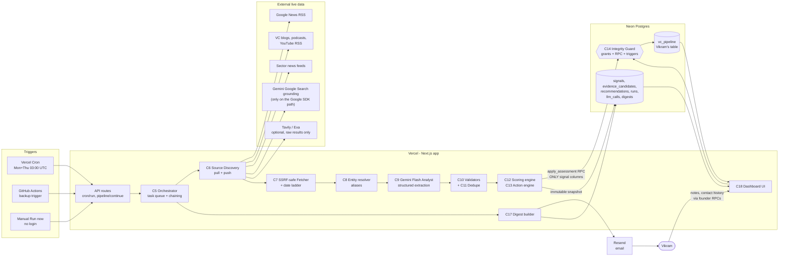

# 02 · Architecture & Components Map  (exam deliverable E6)

> Submit this page (and the in-app `/components-map` route that renders it) as the **Components Map**.

## A. System diagram

## B. Components

| ID | Component | Responsibility | Tech / service | Exam requirement it serves | Secret / env | Cost | If it fails |
|---|---|---|---|---|---|---|---|
| C1 | **Web app + API** | UI + serverless endpoints. Code goes to GitHub; Vercel deploys from `main` | Next.js (App Router, TS) on **Vercel Hobby**, GitHub repo `juilymore/raise-route` | E4 Vercel deploy · public URL | — | Free | Previous deployment stays live |
| C2 | **Scheduler (primary)** | Twice-weekly trigger | **Vercel Cron** `0 3 * * 1,4` (Hobby: once/day max, ±59 min, UTC) | E7 twice a week | `CRON_SECRET` | Free | C3 backup fires |
| C3 | **Scheduler (backup)** | Same-day idempotent trigger | **GitHub Actions** schedule + `workflow_dispatch` | E7 reliability | repo secrets `APP_BASE_URL`, `CRON_SECRET` | Free | Manual Run now |
| C4 | **Database** | Single source of truth, guards, RPC | **Neon Postgres** | E11 live table | `DATABASE_URL`, `DATABASE_URL_UNPOOLED` | Free (scales to zero when idle) | Clear "DB unreachable" state; no fake success |
| C5 | **Orchestrator** | Run lifecycle, idempotent `run_key`, task queue, time-budget chunking + self-continuation, Resume | TS · RPCs `start_run`, `claim_run_tasks`, `finalize_run` | E7 · reliability at 50 VCs | `PIPELINE_TIME_BUDGET_MS` | — | Resume button / next cron |
| C6 | **Source discovery** | (a) official feeds auto-discovery (b) Google News RSS per VC (c) **push model**: global sector feeds matched to VC aliases (d) Gemini grounded search (e) optional Tavily/Exa raw results (f) M3 portfolio diff | `fast-xml-parser`, `fetch`, `@google/genai` tool `google_search` | **E1 live data** · E9 signal types | `GEMINI_API_KEY`, optional `TAVILY_API_KEY`, `EXA_API_KEY` | Free→few $ | Other channels continue; failed channels ⇒ `PARTIAL`, never "quiet" |
| C7 | **Fetcher + extractor** | SSRF-safe fetch, robots.txt, size/time caps, article text, **date ladder** (JSON-LD → meta → feed → `<time>` → URL → model) | `cheerio` | E9 30-day correctness | — | — | Candidate rejected `FETCH_FAILED` / `DATE_UNVERIFIED` |
| C8 | **Entity resolver** | Alias index, ambiguous-name guard (Accel, Eclipse…), firm vs person attribution | TS (+ rare Gemini `disambiguate`) | E9 right VC, right person | — | — | `AMBIGUOUS_ENTITY` reject |
| C9 | **Gemini Flash analyst** | Structured extraction: what happened, event/published date, type, `vc_role`, relevance, strength facts, verbatim excerpt, uncertainties. Also outreach drafts. **Never scores/decides** | `@google/genai`, or the same Gemini models through OpenRouter (`google/gemini-3.7-flash`, no search grounding) · fallbacks · zod-validated JSON | **E3 Gemini only** | `GEMINI_API_KEY` or `OPENROUTER_API_KEY`, `GEMINI_MODEL_*` | Free tier is tiny; ≈ $1/run on paid (estimate) | Fallback model → else candidate `INVALID_MODEL_OUTPUT`, VC `PARTIAL` |
| C10 | **Validators** | V1–V15 deterministic checks incl. **quote verification** (excerpt must exist in fetched text) | TS pure functions | E9 observable, real | — | — | Reject with code (audited) |
| C11 | **Deduper / clusterer** | One event = one signal; syndication ≠ corroboration | TS (normalised subject + ±7d + shingles) | quality | — | — | Duplicate merged as supporting source |
| C12 | **Scoring engine** | 100-pt transparent, versioned, config-driven. Defaults in the config file; the founder can edit the numbers in **Settings > Scoring rubric** (validated, saved as a custom version, applied by code from the next run) | TS · `config/scoring.v1.json` · `app_settings` overrides · matches `golden_vectors.json` | E8 "why" | — | — | Unit-test gate |
| C13 | **Action engine** | Relationship-aware actions (REACH_OUT_NOW / FOLLOW_UP_NOW / MONITOR / HOLD / DON'T_PRIORITIZE / INCOMPLETE) | TS pure | E8 · E10 quiet VCs | — | — | Unit-test gate |
| C14 | **Integrity Guard** | **4 layers**: no table privileges for app role · single write RPC `apply_assessment` · trigger blocks protected-column changes · SHA-256 receipt per run | Postgres grants, SECURITY DEFINER functions, triggers | **E12 + E13** (never overwrite notes) | — | — | Writes rejected loudly; tests in `db/tests/guard_test.sql` |
| C15 | **Snapshot writer** | Immutable `recommendations` per run (+ relationship snapshot without notes) | RPC/insert + immutability trigger | history · explainability | — | — | — |
| C16 | **Outreach drafter** | Short draft grounded only in validated signals + company profile; never auto-sent; no notes sent to model | Gemini (`outreach_draft`) | product value | — | cents | Button shows error; nothing else affected |
| C17 | **Digest builder + sender** | Twice-weekly email from snapshots; immutable archive; truthful status | **Resend** | E7 "before he starts working" | `RESEND_API_KEY`, `DIGEST_RECIPIENT`, `DIGEST_FROM` | Free (100/day) | Status `FAILED` / `DEV_NOT_SENT`, shown honestly |
| C18 | **Dashboard UI** | Command Centre, pipeline table, VC detail, runs, digests, calibration, settings, components map | Next.js · Tailwind · Recharts | E8 · E10 · usability | — | — | — |
| C19 | **Feedback & outcomes** | 👍/👎 per recommendation snapshot; outcome log; calibration view with sample sizes | Postgres + API | learning loop | — | — | — |
| C20 | **Observability** | Run audit, per-VC task status, rejected evidence, source health, **LLM ledger** (proves Gemini-only), Integrity receipts | tables `pipeline_runs`, `run_tasks`, `evidence_candidates`, `source_registry`, `llm_calls` | trust · grading evidence | — | — | — |
| C21 | **Auth & rate limiting** | No login (removed on request). Origin check and rate limit on editing routes; manual-run cooldown; cron bearer secret; the database blocks writes to system columns | zod, Origin check | public URL safe | `CRON_SECRET` | — | — |
| C22 | **Quality gates** | Unit + golden + integration (recorded fixtures) + evals + SQL guard tests + compliance script + CI | Vitest, `scripts/check-compliance.mjs` | credibility | — | — | `npm run verify` red blocks phase |
| C23 | **Docs** | README, this map, runbook, demo script | Markdown | E5 repo | — | — | — |

## C. Data flow (numbered, for the viva)
1. **Trigger** (C2/C3 or Run now) hits `/api/cron/run` with the bearer secret.
2. **C5** calls `start_run()` → DB stores the **founder-data fingerprint** and an idempotent `run_key`; creates 50 `run_tasks`.
3. **C6** pulls evidence two ways: *per VC* (official feeds, Google News RSS, grounded search) and *push* (sector feeds matched to aliases).
4. **C7** fetches each candidate URL safely, extracts text + resolves a trustworthy **date**.
5. **C8** confirms it is really that VC; **C9 (Gemini Flash)** returns a strict JSON event with a **verbatim excerpt**.
6. **C10/C11** verify (quote exists, date in window, role is activity, not duplicate) → qualified **signal** or **rejected candidate (kept, with reason)**.
7. **C12/C13** (pure code) compute the explainable score and the relationship-aware action; **C15** writes an immutable snapshot.
8. **C14** `apply_assessment()` updates *only* `last_signal_date, signal_summary, follow_up_score, recommended_action` (+ derived columns). Notes/contact history cannot change — enforced by privileges, RPC, trigger, and a per-run hash receipt.
9. **C5** `finalize_run()` stores the receipt; **C17** emails the digest; **C18** shows everything; **C19** collects feedback.

## D. Accounts & credentials to gather (do these first)

| # | Account | What you create | Where it goes | Notes |
|---|---|---|---|---|
| 1 | **Google AI Studio** (aistudio.google.com) | API key. **Enable billing (Tier 1) + set a Google Cloud budget alert (e.g. $5–10)** | `GEMINI_API_KEY` | Search grounding on Gemini 3.x needs the paid tier (5,000 free searches/mo then $14/1k). No card? Use `gemini-2.5-flash` (free grounding, 500 RPD) and Google-News-RSS-first discovery. Free-tier prompts may be used by Google to improve products ⇒ app never sends notes. |
| 2 | **Neon** | New project (pick the region nearest Vercel bom1 that Neon offers). Copy the pooled and unpooled connection strings. Run `0000_neon_roles.sql`, `0001`, `0002`, `seed.sql` in the SQL editor, then set a password for `app_service` | `DATABASE_URL` (app_service), `DATABASE_URL_UNPOOLED` (owner, migrations only) | Free tier scales to zero when idle. |
| 3 | **Vercel** (Hobby) | Import the GitHub repo; add all env vars; region `bom1` | env vars | Hobby cron = once/day, UTC, ±59 min. |
| 4 | **GitHub** | **Public** repo | repo link for submission | Add secrets `APP_BASE_URL`, `CRON_SECRET` for the backup workflow. |
| 5 | **Resend** | API key (sign up with the email that should receive digests) | `RESEND_API_KEY`, `DIGEST_RECIPIENT` | No domain needed: send from `onboarding@resend.dev` **to your own signup email only**. |
| 6 | *(optional)* **Tavily** | API key (free 1,000 credits/mo, no card) | `TAVILY_API_KEY` | Raw results only; `include_answer=false`. |
| 7 | *(optional)* **Exa** | API key | `EXA_API_KEY` | Date-filtered neural search; raw results only. |
| 8 | **You** | `FOUNDER_ACCESS_CODE` (any passcode), `SESSION_SECRET` (`openssl rand -hex 32`), `CRON_SECRET` (`openssl rand -hex 32`) | env vars | Put the founder passcode in your submission notes so graders can click **Run now**. |
| 9 | **Claude Code** | Installed + logged in; Node ≥ 20; (optional) Vercel CLI, `gh` | local machine | Claude Code builds the app; **the product itself never calls Claude**. |

## E. Cost envelope (estimates — verify in each console)
Vercel Hobby $0 · Neon Free $0 · GitHub $0 · Resend Free $0 · Gemini paid tier ≈ **$1 per full 50-VC run** (≈100 calls × a few k tokens at $0.75/M in, $3.75/M out through Dec 2026) ⇒ ≈ **$8–10/month** at 2 runs/week + experimentation; grounded searches inside the 5,000/month free allowance.
